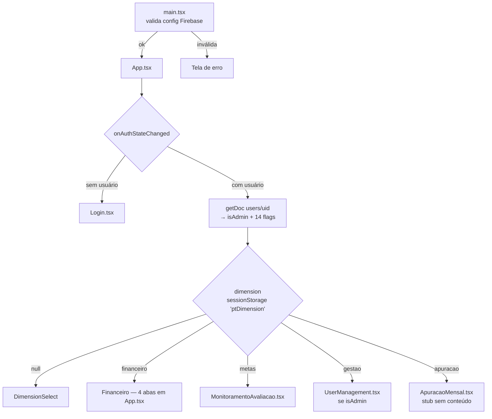

# 01 — Diagnóstico da arquitetura atual

> SIGOSC-EV-004 · versão 1.0 · 06/11/2026 · branch `evo-dev` (commit-base `c130d2f`)
>
> Legenda usada em todos os documentos:
> **[FATO]** foi verificado no código, com o caminho indicado ·
> **[PROPOSTA]** é recomendação arquitetural ·
> **[HIPÓTESE]** é inferência ainda não verificada ·
> **[PENDENTE]** depende de decisão humana.

## 1. Conclusão em uma frase

**[FATO]** Hoje o SIGOSC atende **uma única organização e uma única parceria**. Nenhuma coleção, consulta, regra ou endpoint tem noção de organização (OSC) ou de parceria. Os dados ficam em coleções globais, e a autorização é feita por papel global (`role`) mais 14 permissões booleanas guardadas no próprio documento do usuário.

## 2. Aplicação (A.1)

### 2.1 Stack e dependências
**[FATO]** `package.json`: React 19, Vite 6, TypeScript 5.8, Tailwind 4, `firebase` 12 (Client SDK), `firebase-admin` 12 (servidor), `@vercel/node`, `chart.js`/`recharts`, `exceljs`, `papaparse`, `lucide-react`, `motion`.

### 2.2 Organização dos diretórios
| Diretório | Conteúdo | Tipo |
|---|---|---|
| `src/App.tsx` (551 linhas) | Raiz do app: autenticação, permissões, roteamento por "dimensão" e todo o módulo Financeiro (estado, listeners e handlers) | Ativo |
| `src/components/` | Telas do Financeiro, Gestão de Usuários, Login, Header, Relatório Final, navegação do M&A | Ativo |
| `src/components/ui/`, `src/components/monitor/ui/` | Dois kits de UI ("nativo" e "monitor"), ver `docs/DESIGN_SYSTEM_ANCORA.md` | Ativo |
| `src/pages/monitor/` | Páginas do Monitoramento e Avaliação | Ativo |
| `src/features/` | Domínio do M&A: `visita-in-loco`, `surveys`, `indicators-general` | Ativo |
| `src/services/` | Persistência e cálculos do M&A (30 dias, períodos/colaboradores, classificação, CSV) | Ativo e legado (ver §5.3) |
| `src/config/` | `permissions.ts` (catálogo de permissões) e `firebaseConfig.js` (validação do projeto, EV-002) | Ativo |
| `src/data/` | Municípios de Goiás (estático) | Ativo |
| `api/` | 2 Vercel Functions administrativas e a biblioteca Admin SDK | Ativo |
| `scripts/` | Scripts de migração herdados de outros projetos | Legado (EV-002) |

### 2.3 Inicialização e navegação

- **[FATO]** Não existe router: a navegação é a variável de estado `dimension` em `App.tsx`, persistida em `sessionStorage['ptDimension']` (`getStoredDimension`, `chooseDimension`, `handleGoHome`). As abas internas são estados locais (`activeTab` em `App.tsx` e em `MonitoramentoAvaliacao.tsx`).
- **[FATO]** Não existe Context nem Provider. Permissões e dados do Financeiro descem por props a partir de `App.tsx`. O M&A busca os próprios dados em cada página.
- **[FATO]** `ApuracaoMensal.tsx` é só um título. Ele só é alcançável se `sessionStorage` já tiver `'apuracao'`, porque `DimensionSelect` não oferece essa opção.
- **[FATO]** `isDemoMode` (`App.tsx:36`) nunca vira `true`: `Login.tsx` recebe `onDemoMode`, mas não o usa. É código morto, mas libera os listeners de `ledger`/`budgetItems` sem usuário, e o `authorUid` cai para `'demo-user'` (`handleAddEntry`).
- **[FATO]** `handleFirestoreError` e `OperationType` (`src/firebase.ts`) não são usados em lugar nenhum. O tipo `AuditLogEntry` (`src/types.ts`) também não.

## 3. Autenticação (A.2)

| Item | Implementação atual [FATO] |
|---|---|
| Inicialização | `src/firebase.ts`: `getAuth(app)`, com app único e projeto validado (`sigosc-8f529`) |
| Provedor | Somente e-mail e senha: `signInWithEmailAndPassword` em `Login.tsx` |
| Persistência | `browserSessionPersistence` (a sessão termina ao fechar a aba): `Login.tsx` |
| Estado | `onAuthStateChanged` em `App.tsx:120` |
| Primeiro login | `App.tsx:120-140` cria `users/{uid}` com `role:'user'` e `DEFAULT_PERMISSIONS` (tudo `false`) se o documento não existir |
| Provisionamento | `POST /api/admin/create-user` (Admin SDK) cria a conta com senha temporária aleatória e `users/{uid}`; em seguida o front chama `sendPasswordResetEmail` (`CreateUserModal.tsx`) |
| Recuperação de senha | `sendPasswordResetEmail`, disparado pelo admin em `UserManagement.tsx:58` e `CreateUserModal.tsx:107`. Não existe "esqueci minha senha" na tela de login |
| Exclusão | `POST /api/admin/delete-user`: desabilita, revoga tokens, grava `deletedUsers/{uid}`, apaga `users/{uid}` e depois a conta |
| Logout | `signOut(auth)` e limpeza de `ptDimension` (`handleSignOut`) |
| Proteção de telas | Renderização condicional em `App.tsx` e `MONITORING_NAV[].can` (`MonitoramentoAvaliacao.tsx`) |

**[FATO, risco]** Nada no código impede que alguém crie uma conta pela API pública do Firebase Auth (`accounts:signUp`) usando a `apiKey` do bundle. Essa conta nasce com permissões zeradas, mas passa em `isAuthenticated()`, e várias coleções são legíveis com esse único teste (§5.2). **[PENDENTE]** Confirmar no Console se *Authentication → Settings → User actions → Enable create (sign-up)* está desativado. **[PROPOSTA]** Desativar.

## 4. Autorização (A.3)

### 4.1 Modelo atual
- **[FATO] Papel global:** `users/{uid}.role ∈ {'admin','user'}`. Um admin vê e altera tudo (`isAdmin()` em `firestore.rules:11`).
- **[FATO] Bootstrap por e-mail:** `BOOTSTRAP_ADMIN_EMAIL` aparece em 3 lugares: `src/firebase.ts:78`, `firestore.rules:15` (`request.auth.token.email == "…"`) e a variável `BOOTSTRAP_ADMIN_EMAIL` no servidor (`api/_lib/requireAdmin.ts:33`, `api/admin/delete-user.ts:67`).
- **[FATO] Permissões individuais:** 14 chaves `canAccess*` (`src/config/permissions.ts`), mais 4 chaves legadas (`LEGACY_PERMISSION_KEYS`) que ainda são exigidas por `semPermissoesElevadas()` (`firestore.rules:28`). `canAccessFrequencia` e `canAccessAlcance` estão no catálogo e podem ser ligadas, mas **não controlam nenhuma tela** (as abas Eixo 1 e Eixo 2 não existem em `MONITORING_NAV`).
- **[FATO] Frontend:** `App.tsx:62-117` lê `users/{uid}` uma única vez (`getDoc`, sem listener). Uma permissão revogada só desaparece da interface após recarregar a página. Nos dados, as regras barram na hora.
- **[FATO] APIs:** `requireAdmin()` (`api/_lib/requireAdmin.ts`) valida o ID token e aceita o e-mail de bootstrap ou `role=='admin'`. Não existe noção de escopo.
- **[FATO] Regras:** `hasPermission(field)` lê `users/{uid}` a cada requisição e o default é negar (`match /{document=**}` com `if false`, `firestore.rules:369`).
- **[FATO] Gestão de usuários:** `UserManagement.tsx` grava `role` e `canAccess*` direto pelo Client SDK (`togglePermission`, `toggleRole`), e as regras só aceitam isso de admin (`firestore.rules:123`).

### 4.2 Pontos fortes que devem ser preservados
- Default deny no fim das regras.
- O usuário não consegue se autoconceder permissões: `update` do próprio doc só altera `displayName` (`firestore.rules:123-126`).
- Criação e exclusão de contas só no servidor, sem confiar no payload, com reversão e passos idempotentes (`api/admin/*`).
- Bloqueio de recriação após exclusão (`deletedUsers`).
- Validação estrita do formato das pesquisas importadas (`respostaDePesquisaValida`).

## 5. Persistência (A.4)

### 5.1 Coleções, operações e arquivos

| Coleção (caminho) | Arquivo(s) | Operações [FATO] | ID do documento | Estado |
|---|---|---|---|---|
| `users/{uid}` | `App.tsx`, `UserManagement.tsx`, `pages/monitor/VisitaInLoco.jsx:32`, `api/admin/*` | get, set (1º login), onSnapshot da coleção (admin), update `role`/`canAccess*`, delete (API) | uid do Auth | Ativo |
| `deletedUsers/{uid}` | `api/admin/delete-user.ts`; checado em `firestore.rules:117` | set (API) | uid | Ativo |
| `budgetItems/{id}` | `App.tsx:155` (onSnapshot), `BudgetItems.tsx` | onSnapshot, add, set, update, delete | **código digitado pelo admin** (ex.: `1.1.1.1`) ou automático | Ativo |
| `ledger/{id}` | `App.tsx` | onSnapshot `orderBy(createdAt desc)`, add, update, delete; anexo em Base64 no campo `documentData` (até 2 MB, `ExpenseForm.tsx:27`) | automático | Ativo |
| `settings/partnership` | `RelatorioFinal.tsx:702,758` | get, set merge | fixo `'partnership'` | Ativo, documento único |
| `relatorioFinalRascunho/atual` | `RelatorioFinal.tsx:12,730` | get, set merge (autosave) | fixo `'atual'` | Ativo, documento único |
| `visitas_inloco_caser/{AAAA-MM-DD}` | `features/visita-in-loco/visitaInLocoService.js` | runTransaction (abrir/criar), update, getDocs da coleção, get | **a data da visita** | Ativo |
| `verificacao30dias_{aaaa}_{mm}/{id}` | `services/verificacao30DiasService.js` | add, update, getDocs | automático; **nome de coleção dinâmico por período** | Ativo |
| `verificacao30dias_periodos/{aaaa-mm}` | idem | set merge, getDocs | o período | Ativo |
| `pesquisas_{aprendiz,mentor,responsavel,egresso}_respostas/{sourceResponseId}` | `features/surveys/import/surveyFirestoreService.js` | writeBatch set, getDocs, getCountFromServer | **ID da resposta no Microsoft Forms** | Ativo |
| `pesquisas_importacoes/{id}` | idem | set (no batch), query `where(surveyType)` | automático | Ativo |
| `periodos/{id}` | `services/firestoreService.js` | **só leitura** ativa (`buscarPeriodos`, usada pelo Painel Geral) | automático | Leitura ativa, escrita legada |
| `colaboradores_{aaaa}_{mm}/{id}` | idem | **só leitura** ativa (`buscarDadosPeriodo`) | automático; coleção dinâmica | Leitura ativa, escrita legada |

### 5.2 Leitura liberada só por estar autenticado [FATO]
`settings` (`firestore.rules:152`), `periodos` (`:192`), `colaboradores_*` (`:206`), `verificacao30dias_*` (`:252`), `verificacao30dias_periodos` (`:268`) e `relatorioFinalRascunho` (`:363`) aceitam leitura de **qualquer usuário autenticado**. Num ambiente multi-tenant, isso seria vazamento entre OSCs. Hoje, combinado com o cadastro público do §3, também é uma exposição.

### 5.3 Código legado e caminhos sem uso
- **[FATO]** `salvarPeriodo` e `excluirPeriodo` (`services/firestoreService.js`) não têm chamadores. Elas pertenciam à antiga Apuração Mensal (removida). `periodos` e `colaboradores_*` ainda são **lidas** pelo Painel Geral (`useGeneralIndicators.js:60-66`), mas nada no app grava nelas.
- **[HIPÓTESE]** Como o Firestore do `sigosc-8f529` foi criado na EV-002 e nada foi copiado, `periodos` e `colaboradores_*` provavelmente estão vazias. **[PENDENTE]** Confirmar com uma contagem somente leitura numa evolução futura (EV-012).
- **[FATO]** As regras ainda citam permissões legadas (`canAccessUpload`, `canAccessHistorico`) nessas coleções.

### 5.4 Relacionamentos implícitos [FATO]
- `ledger.itemCode → budgetItems.id`. Não há chave estrangeira; os totais casam pelo código em texto (`App.tsx` `totals`/`chartData`).
- `ledger.authorUid`, `visitas.vistoriador.uid` e `verificacao30dias.metadata.createdBy` apontam para `users.uid`, e as regras dependem disso.
- O Relatório Final usa `settings/partnership` (dados do instrumento) mais o rascunho único.
- `pesquisas_importacoes.importadoPorUid` aponta para `users.uid`.

### 5.5 Dados da parceria escritos no código [FATO]
- `features/visita-in-loco/config.js` → `IDENTIFICACAO_INSTRUMENTO`: "Termo de Colaboração nº 02/2026 - SEDS/GO", processo SEI, unidade "CASER Rio Verde", OSC "FAMI". A identidade da parceria está no código-fonte.
- `features/indicators-general/catalog.ts`: catálogo estático de 44 indicadores ("matriz RENAPSI").
- `src/data/municipios-goias.json`: a abrangência geográfica está fixa em Goiás.
- `RelatorioFinal.tsx` → `DEFAULT_PARTNERSHIP` contém "SEDS" como administração.

Para multi-tenant, esses dados precisam virar **dados da parceria** ou **configuração versionada por tipo de programa** (ver 02 e 09).

## 6. Infraestrutura (A.5)

| Componente | Situação [FATO] | Impacto multi-tenant |
|---|---|---|
| Client SDK | Inicializado só em `src/firebase.ts`, validado por `firebaseIsolation.test.js` | Baixo: continua único; muda só *o que* é consultado |
| Admin SDK | `api/_lib/firebaseAdmin.ts`, travado em `sigosc-8f529`. **Ignora as Security Rules** | Alto: toda API precisa de checagem explícita de escopo |
| Firestore | 13 famílias de coleções globais, 2 delas com nome dinâmico | Alto: reestruturação de caminhos |
| Storage | **Não usado.** Anexos em Base64 dentro de `ledger` | Médio: logomarca por OSC (futuro) e possivelmente anexos |
| Vercel Functions | `api/admin/create-user.ts` e `api/admin/delete-user.ts` | Alto: passam a ter escopo de organização |
| Variáveis de ambiente | `VITE_FIREBASE_*` (6), `FIREBASE_ADMIN_*` (3), `BOOTSTRAP_ADMIN_EMAIL` | `BOOTSTRAP_ADMIN_EMAIL` deve ser aposentada (ADR-007) |
| Testes | `node --test`: 31 testes (config/isolamento do Firebase e a fórmula da Visita In Loco). **Não há testes de regras nem emulador** | Alto: um pré-requisito de segurança é criá-los |
| Deploy | Vercel (sem `vercel.json`), regras publicadas à mão no Console (sem `firebase.json`/`.firebaserc`) | Médio: publicar regras deve ser versionado e testado |
| Índices | Nenhum composto. Consultas de campo único | Médio: consultas com escopo e collection group vão exigir índices |

## 7. Impacto resumido por componente

| Componente | Função atual | Impacto previsto |
|---|---|---|
| `App.tsx` | Raiz, permissões e Financeiro | **Alto**: separar o contexto de tenant e tirar o Financeiro da raiz |
| `permissions.ts` | Catálogo de permissões | **Médio**: as chaves continuam, mas valem por vínculo e por parceria |
| `UserManagement.tsx` e modais | Gestão global de usuários | **Alto**: vira gestão de **membros da OSC**, e a administração global se separa |
| `api/_lib/requireAdmin.ts` | Admin global | **Alto**: substituído por `requireOrgRole` / `requirePlatformAdmin` |
| `firestore.rules` | Regras globais | **Alto**: reescrita para caminhos com escopo |
| Serviços do M&A | Coleções globais e dinâmicas | **Alto**: caminhos por parceria; acabar com coleções de nome dinâmico |
| `RelatorioFinal.tsx` | Parceria e rascunho únicos | **Alto**: um registro por parceria |
| `visita-in-loco/config.js` | Identidade da parceria no código | **Médio**: vira dado da parceria |
| Kits de UI e `BrandWordmark` | Visual | **Baixo** (logo por OSC é futuro) |

## 8. Lacunas que o diagnóstico não pôde fechar
1. **[PENDENTE]** Volume real de documentos em cada coleção do `sigosc-8f529`. Não foi consultado, porque esta evolução proíbe acessar o Firebase.
2. **[PENDENTE]** Configuração de cadastro público no Firebase Auth (§3).
3. **[PENDENTE]** Se o catálogo de indicadores e os instrumentos de M&A valem para todas as OSCs ou dependem do tipo de programa.
