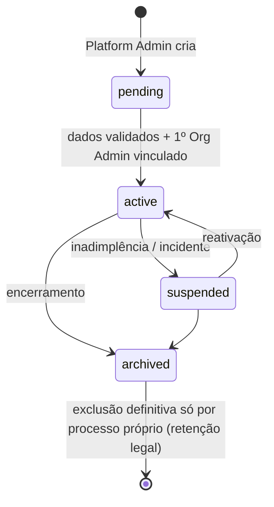
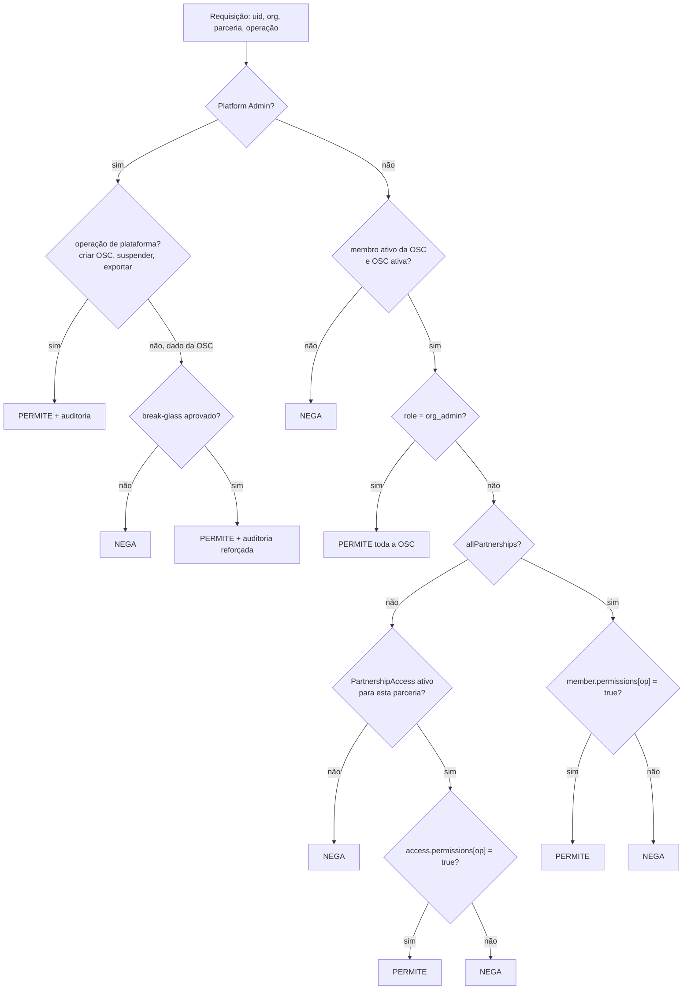
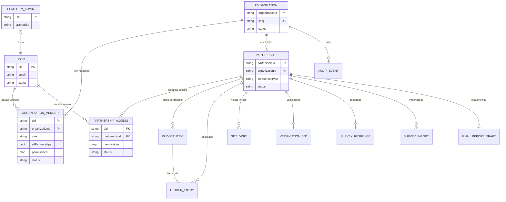

# 02 — Modelo de domínio multi-tenant

> SIGOSC-EV-004 · versão 1.0 · 06/11/2026. Legenda: **[FATO] [PROPOSTA] [HIPÓTESE] [PENDENTE]** (ver 01).

## 1. Inventário e classificação das entidades atuais (Etapa B)

Classes: **GLOBAL**, **ORGANIZAÇÃO**, **PARCERIA**, **IDENTIDADE**, **VÍNCULO**, **LEGADO**.
Sensibilidade: **A** = dados pessoais ou financeiros, **M** = operacional interno, **B** = configuração.
Complexidade de adaptação: **B** = baixa, **M** = média, **A** = alta.

| Entidade | Caminho atual | Arquivo | Informação | Operações | Relações | ID atual | Assoc. OSC | Assoc. parceria | Sens. | Classe proposta | Isolamento recomendado | Compl. |
|---|---|---|---|---|---|---|---|---|---|---|---|---|
| Perfil de usuário | `users/{uid}` | `App.tsx`, `UserManagement.tsx`, `api/admin/*` | e-mail, nome, `role`, 14+4 flags | get, set, update, onSnapshot, delete | ← autoria em várias coleções | uid | Não (identidade global) | Não | A | **IDENTIDADE** (perfil) + **VÍNCULO** (role/flags saem daqui) | `users/{uid}` só com perfil mínimo; papéis vão para os vínculos | A |
| Bloqueio de conta excluída | `deletedUsers/{uid}` | `delete-user.ts` | uid e data | set | users | uid | Não | Não | B | **IDENTIDADE** (plataforma) | Somente servidor e Platform Admin | B |
| Item do plano | `budgetItems/{id}` | `BudgetItems.tsx`, `App.tsx` | etapa, grupo, categoria, valor | CRUD, onSnapshot | ← `ledger.itemCode` | código digitado | Sim | **Sim** | M | **PARCERIA** | Subcoleção da parceria; o código vira campo, não ID global | M |
| Lançamento de despesa | `ledger/{id}` | `App.tsx` | NF, fornecedor, valor, anexo Base64, aprovação | CRUD, onSnapshot | → budgetItems, users | auto | Sim | **Sim** | **A** | **PARCERIA** | Subcoleção da parceria; anexo para o Storage com caminho da parceria [PENDENTE] | A |
| Dados da parceria | `settings/partnership` | `RelatorioFinal.tsx` | instrumento, SEI, OSC, objeto, valores | get, set | Relatório Final | fixo | Sim | **É a parceria** | M | **PARCERIA** (vira a própria entidade `Partnership`) | Campos do doc `partnerships/{id}` | M |
| Rascunho do Relatório Final | `relatorioFinalRascunho/atual` | `RelatorioFinal.tsx` | estado do formulário | get, set (autosave) | parceria | fixo | Sim | **Sim** | M | **PARCERIA** | `…/partnerships/{id}/finalReport/draft` | M |
| Visita In Loco | `visitas_inloco_caser/{data}` | `visitaInLocoService.js` | apuração, vistoriador | transação, update, list | users | **data** | Sim | **Sim** | M | **PARCERIA** | Subcoleção da parceria; ID = data **dentro** da parceria | M |
| Verificação 30 dias | `verificacao30dias_{aaaa}_{mm}/{id}` | `verificacao30DiasService.js` | respostas de aprendizes (pessoais) | add, update, list | users | auto; coleção dinâmica | Sim | **Sim** | **A** | **PARCERIA** | Uma coleção fixa por parceria com o campo `periodoAplicacao` (fim da coleção dinâmica) | A |
| Períodos da Verificação 30 dias | `verificacao30dias_periodos/{periodo}` | idem | lista de períodos | set, list | ↔ coleção acima | período | Sim | **Sim** | B | **PARCERIA** | Derivado ou subcoleção da parceria | B |
| Respostas de pesquisas (4) | `pesquisas_*_respostas/{sourceResponseId}` | `surveyFirestoreService.js` | respostas (pessoais) | batch set, list, count | importações | **ID do Forms** | Sim | **Sim** | **A** | **PARCERIA** | Subcoleção da parceria; o ID do Forms só é único dentro dela | A |
| Histórico de importação | `pesquisas_importacoes/{id}` | idem | auditoria de importação | set, query | users | auto | Sim | **Sim** | M | **PARCERIA** | Subcoleção da parceria, imutável | M |
| Períodos de colaboradores | `periodos/{id}` | `firestoreService.js` | metadado de importação | só leitura ativa | ↔ colaboradores_* | auto | Sim | Sim | B | **LEGADO** | Decidir entre reativar como dado da parceria e remover [PENDENTE] | M |
| Colaboradores (aprendizes) | `colaboradores_{aaaa}_{mm}/{id}` | idem | dados pessoais de aprendizes | só leitura ativa | ↔ periodos | auto; coleção dinâmica | Sim | Sim | **A** | **LEGADO** | Idem; sem gravação ativa no app | A |
| Catálogo de 44 indicadores | código (`catalog.ts`) | — | metas e fórmulas | leitura estática | Painel Geral | sigla | Talvez | Talvez | B | **GLOBAL** (versionado) — **[PENDENTE]** se varia por tipo de programa | Versionar por `programType` | M |
| Instrumento da Visita In Loco | código (`visita-in-loco/config.js`) | — | identificação da parceria e itens | estático | visitas | — | Sim | **Sim** | B | Identificação → **PARCERIA**; itens e fórmula → **GLOBAL** versionado | Separar dado de regra | M |
| Municípios de Goiás | código (`src/data`) | — | referência geográfica | estático | pesquisas, 30 dias | código IBGE | Não | Não | B | **GLOBAL** | Manter global; a UF de atuação vira atributo da parceria [PENDENTE] | B |

**[FATO]** Nenhuma entidade atual é de nível ORGANIZAÇÃO: o conceito de OSC não existe no código. As entidades novas `Organization`, `OrganizationMember` e `PartnershipAccess` serão criadas.

## 2. Entidades propostas [PROPOSTA]

### 2.1 Organization (raiz do tenant)
| Campo | Tipo | Regra |
|---|---|---|
| `organizationId` | string, ID do documento | **Gerado pelo sistema** (ID automático do Firestore). Nunca derivado do CNPJ, porque o CNPJ pode ser corrigido e o ID precisa ser estável |
| `legalName` | string | Razão social |
| `displayName` | string | Nome exibido na interface |
| `cnpj` | string | **Normalizado com 14 dígitos, sem máscara**, validado por dígito verificador |
| `status` | `'pending' \| 'active' \| 'suspended' \| 'archived'` | Ciclo de vida abaixo |
| `branding` | `{ logoPath?, ... }` | Futuro (EV de identidade visual); só referência ao arquivo |
| `createdAt`, `updatedAt`, `createdBy` | timestamp, uid | Auditoria |

**Unicidade do CNPJ:** o Firestore não tem índice único. **[PROPOSTA]** Usar a coleção de reserva `organizationCnpjIndex/{cnpj}` → `{ organizationId }`, criada **na mesma transação** que a organização, somente pelo servidor.

**Ciclo de vida:**

Somente `active` permite operar. `suspended` bloqueia leitura e escrita para os membros. `archived` permite apenas exportação pelo Platform Admin.

### 2.2 Partnership (parceria)
| Campo | Tipo | Regra |
|---|---|---|
| `partnershipId` | ID do documento | Gerado pelo sistema |
| `organizationId` | string | **Redundante com o caminho** e conferido pelas regras (`== organizationId` do path) |
| `title` | string | |
| `instrumentType` | `'TERMO_COLABORACAO' \| 'TERMO_FOMENTO' \| 'ACORDO_COOPERACAO' \| 'OUTRO'` | Enumeração aberta; nenhuma regra de negócio específica nesta fase |
| `instrumentNumber` | string | Ex.: "02/2026" |
| `processNumber` | string | Processo SEI (hoje em `settings/partnership.processoSei`) |
| `grantingAgency` | string | Órgão concedente (hoje "SEDS", escrito no código) |
| `object`, `globalValue`, `plannedExpenses` | | Migram de `settings/partnership` |
| `programType` | string | Liga a parceria ao catálogo de indicadores e instrumentos de M&A **[PENDENTE]** |
| `status` | `'draft' \| 'active' \| 'closed' \| 'archived'` | |
| `startDate`, `endDate` | data ISO | |
| `createdAt`, `updatedAt` | | |

**Cardinalidade:** uma Organization tem 0..N Partnerships, e cada Partnership pertence a exatamente 1 Organization, para sempre (não é transferível).

### 2.3 User (identidade global)
`users/{uid}`: `uid`, `displayName`, `email` (minúsculo, espelho do Auth), `status` (`'active' | 'disabled'`), `createdAt`. **Sem papéis e sem permissões.** Um único documento por pessoa, seja qual for o número de OSCs, o que evita identidades duplicadas.

### 2.4 OrganizationMember (vínculo usuário ↔ OSC)
| Campo | Regra |
|---|---|
| `uid`, `organizationId` | Chave composta (ver 03 para o caminho) |
| `role` | `'org_admin' \| 'org_user'` |
| `status` | `'invited' \| 'active' \| 'revoked'` |
| `permissions` | Mapa das chaves do catálogo (`canAccess*`) com **valor padrão da OSC**. Só vale onde a política permite (ver §2.5) |
| `allPartnerships` | boolean: `true` dá acesso a todas as parcerias da OSC (padrão para `org_admin`, explícito para `org_user`) |
| `createdAt`, `updatedAt`, `createdBy`, `revokedAt`, `revokedBy` | Auditoria |

Uma pessoa tem 0..N vínculos, e uma OSC tem 1..N vínculos (pelo menos um `org_admin` ativo quando `active`).

### 2.5 PartnershipAccess (vínculo usuário ↔ parceria)
`uid`, `organizationId`, `partnershipId`, `permissions` (mapa `canAccess*`), `status`, `grantedBy`, `grantedAt`.

**Política de resolução** (negar por padrão):

- A permissão da parceria **não se soma** à da OSC: quem tem `allPartnerships:false` usa **apenas** o `PartnershipAccess`, o que evita uma concessão implícita.
- A ausência de documento ou de chave resulta em **negação**.
- **[PENDENTE]** Se `org_admin` deve ter acesso automático aos **dados** de todas as parcerias, ou só à gestão. A proposta inicial é sim, porque reflete a responsabilidade legal da OSC.

### 2.6 Identidade visual (futuro)
`Organization.branding`: `displayName` (já previsto), `logoPath` (Storage: `organizations/{orgId}/branding/logo.*`), dados institucionais. O design system continua central; só o **conteúdo** varia (logo e nome), sem cores por tenant. **Fora do escopo** até uma evolução própria.

## 3. Diagrama de domínio

## 4. Invariantes do domínio [PROPOSTA]
1. Todo dado de negócio tem exatamente uma `organizationId`, e todo dado operacional tem uma `partnershipId`. Esses valores vêm **do caminho**, nunca do payload.
2. `organizationId`, `partnershipId` e as chaves de autoria são **imutáveis** depois da criação.
3. Um vínculo `revoked` nunca concede acesso, nem que os campos `permissions` continuem preenchidos.
4. O papel de plataforma (Platform Admin) **não é** um papel de OSC e não aparece em `OrganizationMember`.
5. Uma OSC `active` tem pelo menos um `org_admin` ativo, e o servidor impede remover o último.
