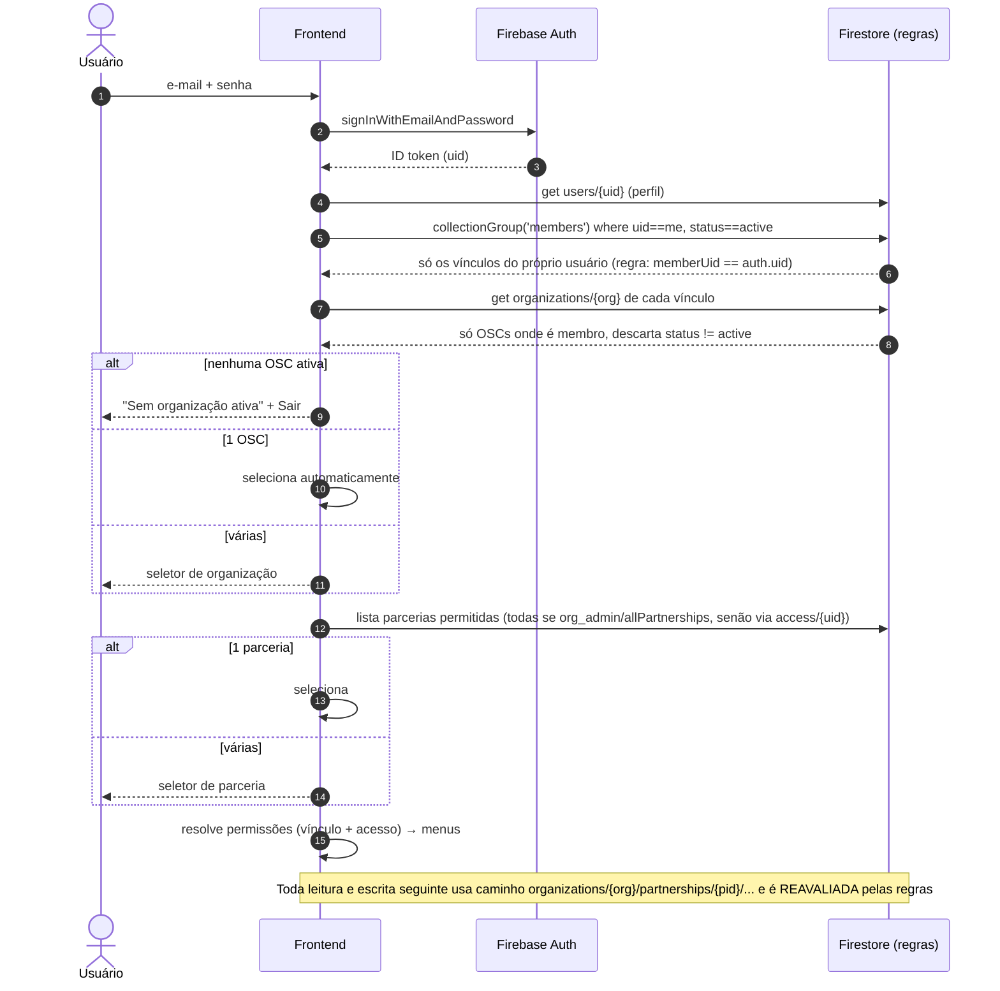

# 04 — Autenticação e autorização

> SIGOSC-EV-004 · versão 1.0 · 06/11/2026. Legenda: **[FATO] [PROPOSTA] [HIPÓTESE] [PENDENTE]**.

## 1. Quatro conceitos separados [PROPOSTA]

| Conceito | Pergunta | Fonte de verdade | Quem altera |
|---|---|---|---|
| **Identidade** | Quem é? | Firebase Auth + `users/{uid}` (perfil mínimo) | O próprio usuário (nome) e o servidor |
| **Vínculo** | A quais OSCs e parcerias pertence? | `organizations/{org}/members/{uid}` e `…/partnerships/{pid}/access/{uid}` | **Somente o servidor** (APIs), após checagem |
| **Contexto ativo** | Em qual OSC e parceria está trabalhando agora? | Estado do frontend (memória + `sessionStorage`) | O usuário, pela interface. **Não é prova de nada** |
| **Permissão** | O que pode fazer nesse contexto? | Calculada a partir do vínculo, **reavaliada pelas regras e pela API a cada operação** | — |

**[FATO]** Hoje esses quatro conceitos estão juntos em `users/{uid}`: `role` e `canAccess*` ficam no perfil, e o "contexto" é a `dimension` em `App.tsx`.

## 2. Papéis

| Papel | Escopo | Pode | Não pode |
|---|---|---|---|
| **Platform Admin** | Plataforma | Criar, suspender e arquivar OSCs; nomear o 1º `org_admin`; ver dados operacionais da plataforma (contagens, status); exportar uma OSC por solicitação formal | Ler ou alterar dados de negócio de OSCs no uso normal (só com **break-glass** auditado, ADR-006) |
| **Organization Admin** (`org_admin`) | Uma OSC | Gerir membros e acessos da **sua** OSC; criar e encerrar parcerias; acesso total aos dados das parcerias da OSC **[PENDENTE, ver 02 §2.5]** | Agir em outra OSC; se tornar Platform Admin; remover o último `org_admin` |
| **Organization User** (`org_user`) | Uma OSC e as parcerias autorizadas | O que as chaves `canAccess*` do vínculo ou do `PartnershipAccess` permitirem | Alterar o próprio vínculo ou papel; ver parcerias sem acesso |

- **Permissões por módulo:** as 14 chaves de `src/config/permissions.ts` continuam (ADR-005), mas passam a valer **por vínculo**. `canAccessFrequencia` e `canAccessAlcance` não controlam nenhuma tela hoje **[FATO]**. **[PENDENTE]** Decidir se saem do catálogo.
- **Permissões por parceria:** são necessárias (requisito 7 do negócio), via `PartnershipAccess`, conforme a política de 02 §2.5.

### 2.1 Mapeamento do modelo atual (sem conversão automática)
| Hoje | Futuro |
|---|---|
| `users.role == 'admin'` | **Não** vira Platform Admin automaticamente. Na migração, cada admin atual vira `org_admin` **da OSC que for decidida** para os dados legados (07), após confirmação humana |
| E-mail de bootstrap (`BOOTSTRAP_ADMIN_EMAIL`) | Aposentado. O 1º Platform Admin é provisionado pelo procedimento do §3 |
| `canAccess*` em `users/{uid}` | Copiados para `members/{uid}.permissions` da OSC decidida; o perfil fica sem flags |

## 3. Provisionamento do primeiro Platform Admin [PROPOSTA] (ADR-007)
Objetivo: **nenhum e-mail fixo nas regras, no código ou em variável de ambiente**.

1. Um operador com acesso ao projeto GCP roda **uma vez**, na própria máquina, um script de linha de comando com a credencial da conta de serviço:
   `node scripts/platform/grant-platform-admin.mjs --uid <uid> --confirm` (será criado numa EV futura).
2. O script exige `--confirm`, confere o projeto (`sigosc-8f529`), confirma que o uid existe no Auth e grava `platformAdmins/{uid} = { grantedAt, grantedBy: 'bootstrap-cli', note }`.
3. As regras negam **toda** escrita do cliente em `platformAdmins` (`allow write: if false`). Só o Admin SDK escreve.
4. Os Platform Admins seguintes são nomeados por um endpoint que exige Platform Admin **e** registra auditoria. **[PENDENTE]** Exigir aprovação de dois Platform Admins?
5. A revogação apaga `platformAdmins/{uid}`. Como as regras usam `exists()`, o efeito é **imediato**, sem esperar o token renovar (vantagem sobre custom claims).
6. Só depois de existir um Platform Admin pelo novo método é que o e-mail de bootstrap sai de `firestore.rules`, `src/firebase.ts` e `requireAdmin.ts`. As duas mudanças precisam ir **no mesmo deploy** (ver 08, EV-007).

## 4. Fluxos

### 4.1 Login → contexto → permissões


### 4.2 Troca de organização (ou de parceria)
1. Cancelar **todos** os listeners (`onSnapshot`) do contexto anterior.
2. Limpar o estado de dados (financeiro, M&A, caches de painéis) e os rascunhos em memória. Antes, forçar o `saveNow` do autosave pendente no contexto antigo.
3. Trocar o contexto (`{organizationId, partnershipId}`) e só depois reabrir os listeners.
4. **[PROPOSTA]** Implementar com um `TenantProvider` cuja `key` seja `${org}:${pid}`. Ao trocar, a árvore inteira é desmontada e remontada, o que elimina por construção qualquer listener ou estado esquecido.

**[FATO, risco]** Hoje os listeners de `ledger` e `budgetItems` ficam em `App.tsx` e dependem só de `user`. Se o tenant for incluído sem o mecanismo acima, um listener do tenant anterior pode continuar recebendo dados.

### 4.3 Revogação de vínculo
- O servidor marca `members/{uid}.status = 'revoked'` (ou remove `access/{uid}`) e grava auditoria.
- **Firestore:** as regras leem o vínculo a cada requisição, então novas leituras e escritas são negadas imediatamente.
- **Listeners já abertos:** **[HIPÓTESE]** o Firestore pode não encerrar na hora um listener ativo quando um documento *usado pela regra* muda. Validar no emulador (EV-005). **[PROPOSTA]** Mitigar das duas formas: (a) o frontend escuta o próprio `members/{uid}` e, se ele mudar para `revoked`, desmonta o contexto; (b) o servidor chama `revokeRefreshTokens(uid)` quando o usuário perde **todos** os vínculos.
- **APIs:** sempre reconsultam o vínculo, sem cache.

### 4.4 Expiração e alteração de sessão
- `browserSessionPersistence` continua **[FATO]**. O ID token expira em cerca de 1 h e é renovado sozinho. A conta desabilitada ou com tokens revogados perde a renovação.
- Se `onAuthStateChanged` devolver `null` ou outro uid, o `TenantProvider` é desmontado e o `sessionStorage` do contexto é limpo.
- O contexto guardado em `sessionStorage` é **revalidado** a cada carregamento: o vínculo e a parceria precisam continuar ativos.

### 4.5 Organização desativada
A regra `orgActive(org)` (03 §9) nega tudo. O frontend detecta pelo documento da OSC e mostra "Organização suspensa".

## 5. APIs (Vercel + Admin SDK)

**[FATO]** O Admin SDK ignora as Security Rules. Toda autorização das APIs precisa ser **explícita no código**.

### 5.1 Helpers propostos (substituem `requireAdmin`)
```ts
// Documentação — não implementado
requireUser(req) -> { uid, email }                                  // verifica ID token (checkRevoked: true)
requirePlatformAdmin(req) -> { uid }                                // exists platformAdmins/{uid}
requireOrgRole(req, orgId, roles: ('org_admin'|'org_user')[]) -> { uid, member }
     // lê organizations/{orgId} (status active) e members/{uid} (status active, role ∈ roles)
requirePartnershipPermission(req, orgId, pid, perm) -> { uid }
     // aplica a MESMA política de 02 §2.5
```
- `orgId` e `pid` vêm do **caminho da rota** (`/api/orgs/{orgId}/...`), são validados como IDs (`^[A-Za-z0-9_-]{1,64}$`) e a existência é conferida. **Nunca** são lidos do corpo.
- O corpo é lido por **lista de campos permitidos** (padrão já usado em `create-user.ts`).
- `verifyIdToken(token, true)`, com `checkRevoked`, para detectar revogação.

### 5.2 Endpoints previstos
| Endpoint | Autorização | Efeito |
|---|---|---|
| `POST /api/platform/organizations` | Platform Admin | Cria OSC `pending` + reserva do CNPJ (transação) + auditoria |
| `POST /api/platform/organizations/{org}/status` | Platform Admin | Ativa, suspende ou arquiva |
| `POST /api/orgs/{org}/members` | `org_admin` de `{org}` (ou Platform Admin para o 1º admin) | Convida: cria a conta no Auth se não existir (o fluxo atual do `create-user`) + `members/{uid}` |
| `PATCH /api/orgs/{org}/members/{uid}` | `org_admin` de `{org}` | Muda papel e permissões; impede alterar o próprio papel e remover o último `org_admin` |
| `DELETE /api/orgs/{org}/members/{uid}` | `org_admin` de `{org}` | **Revoga o vínculo** (não apaga a identidade global) |
| `PUT/DELETE /api/orgs/{org}/partnerships/{pid}/access/{uid}` | `org_admin` de `{org}` | Concede ou revoga acesso por parceria |
| `DELETE /api/platform/users/{uid}` | Platform Admin | Exclui a **identidade** (o fluxo atual do `delete-user`), só se o uid não tiver vínculos ativos ou após revogar todos |

**[FATO]** O `delete-user` atual apaga a identidade global. No modelo multi-tenant, um `org_admin` **nunca** pode excluir a conta de uma pessoa que também pertence a outra OSC (cenário C03), por isso a separação acima.

### 5.3 Vínculos alterados só no servidor
**[PROPOSTA] (ADR-008)** As coleções `members`, `access`, `platformAdmins`, `organizationCnpjIndex` e `auditEvents` aceitam **leitura** conforme o escopo e **negam toda escrita do cliente**. Isso elimina por construção a escalada vertical (C09) e a alteração indevida de vínculos. Hoje **[FATO]** `UserManagement.tsx` escreve `role` e `canAccess*` direto pelo Client SDK, e essa escrita passaria para as APIs.
