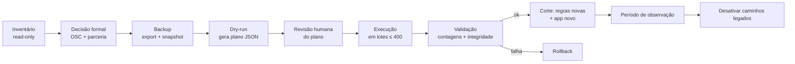

# 07 — Estratégia de transição (não executada)

> SIGOSC-EV-004 · versão 1.0 · 06/11/2026. Legenda: **[FATO] [PROPOSTA] [HIPÓTESE] [PENDENTE]**.
>
> **Nenhuma migração pode ser executada sem uma evolução específica e autorização posterior.** Este documento só descreve o plano.

## 1. Ponto de partida
- **[FATO]** O Firestore do `sigosc-8f529` foi criado na EV-002, sem copiar nenhum dado do projeto de origem.
- **[HIPÓTESE]** O volume atual é pequeno: usuários de teste, talvez itens e despesas de validação. **[PENDENTE]** Confirmar pelo inventário do §2 antes de qualquer decisão. Se o banco estiver vazio ou só tiver dados de teste, a "migração" pode virar **começar do zero**, e essa é a opção mais segura (ADR-010).

## 2. Inventário dos dados existentes (só leitura)
Script de servidor `scripts/platform/inventory.mjs` (EV futura), **somente leitura**, que gera um relatório local **sem dados pessoais**:
- contagem por coleção (`users`, `ledger`, `budgetItems`, `visitas_inloco_caser`, `verificacao30dias_*` por período, `pesquisas_*`, `pesquisas_importacoes`, `settings`, `relatorioFinalRascunho`, `periodos`, `colaboradores_*`, `deletedUsers`);
- datas mínima e máxima por coleção;
- listagem de coleções da raiz (`listCollections()`) para achar **coleções desconhecidas**;
- usuários: total, quantos admins, quantos com cada `canAccess*`.

## 3. Critérios para a OSC dona dos dados legados
**Não presumir** que pertencem à primeira OSC cadastrada. O dono é decidido por evidência, com registro formal:
1. `settings/partnership` (campo `osc`) e `visita-in-loco/config.js` (`oscParceira: 'Fundação de Apoio ao Menor Inhumense (FAMI)'`) **[FATO]** indicam a parceria de origem.
2. O responsável pela plataforma **confirma por escrito** a OSC dona e o instrumento (número e processo SEI) antes da migração.
3. Se não houver confirmação, os dados ficam **em quarentena** (§6) e não são migrados.

## 4. Critérios para associar registros a parcerias
- No modelo atual existe **uma** parceria implícita. Todos os registros de negócio vão para a parceria criada a partir de `settings/partnership` + `IDENTIFICACAO_INSTRUMENTO`, **desde que** §3 tenha sido confirmado.
- Para cada registro, conferir sinais de consistência: as datas devem estar dentro da vigência (`periodoIni`/`periodoFim`), e `authorUid`/`vistoriador.uid` devem existir em `users`.

## 5. Órfãos e ambiguidades
| Situação | Tratamento |
|---|---|
| `ledger.itemCode` sem `budgetItems` correspondente | Migrar e marcar `integrityFlag: 'orphan_item'`; relatório para revisão |
| Autor (`authorUid`, `createdBy`) inexistente em `users` | Migrar mantendo o uid; marcar |
| Data fora da vigência da parceria | **Quarentena** |
| Usuário sem nenhuma permissão e sem autoria | Não criar vínculo (fica só a identidade) |
| Admin atual (`role:'admin'`) | Vira `org_admin` **apenas** se confirmado (04 §2.1); **nunca** Platform Admin automático |
| `colaboradores_*`/`periodos` (legado) | Decisão explícita: migrar como dado da parceria ou arquivar [PENDENTE] |

## 6. Backup prévio
1. **Exportação gerenciada** do Firestore (`gcloud firestore export gs://<bucket-backup>/<data>`), feita pelo operador com acesso ao projeto. **Não é feita nesta evolução.**
2. Snapshot JSON por coleção (script de leitura), guardado fora do repositório (`/backups/` já está no `.gitignore` **[FATO]**).
3. Anotar a contagem por coleção (§2) **antes** da migração.

## 7. Plano de migração idempotente

- **Idempotência:** o ID de destino é **determinístico** a partir do ID de origem (por exemplo, `ledger/{id}` vira `…/ledger/{id}`). Rodar de novo sobrescreve com o mesmo conteúdo, sem duplicar.
- Cada documento migrado recebe `migration: { sourcePath, migratedAt, runId }`.
- O script **nunca apaga** a origem. Apagar a origem é uma etapa separada, depois da observação (§10).
- `--dry-run` é o padrão. A execução exige `--execute --run-id=<id>`, e o projeto é conferido (`sigosc-8f529`).

## 8. Validação antes e depois e reconciliação
| Verificação | Critério |
|---|---|
| Contagem por coleção | origem = destino + quarentena |
| Soma financeira | `Σ ledger.amount` e `Σ budgetItems.value` iguais na origem e no destino |
| Amostragem | 5% dos docs (no mínimo 20) comparados campo a campo |
| Integridade | Todo `ledger.itemCode` resolve dentro da parceria (exceto os marcados) |
| Escopo | Todo documento migrado tem `organizationId`/`partnershipId` iguais ao caminho |
| Acesso | Bateria C01–C16 (05) contra os dados migrados no emulador e depois no ambiente real |

## 9. Rollback
- Antes do corte: basta não publicar as regras e o app novos; os dados migrados ficam ignorados.
- Depois do corte: **republicar** a versão anterior das regras e do app (`main` anterior) e usar a origem, que continua intacta. As escritas feitas no destino durante a janela são exportadas e reconciliadas manualmente. Por isso a **janela de corte deve ser curta e sem uso**.

## 10. Compatibilidade temporária e desativação do legado
- Coexistência só **enquanto houver uma única OSC** em produção. Nesse período, as regras legadas continuam e as novas são acrescentadas. **Nunca** liberar uma 2ª OSC com as coleções globais ainda legíveis (o isolamento não seria garantido).
- **Desativar:** (1) regras legadas viram `allow read, write: if false`; (2) remover o código que lê caminhos globais; (3) após a retenção acordada, apagar as coleções legadas por um script com dupla confirmação.

## 11. Entrada da primeira OSC
1. O Platform Admin é provisionado (ADR-007).
2. A OSC é criada como `pending`, com o CNPJ validado.
3. A parceria é criada a partir dos dados confirmados.
4. O 1º `org_admin` é vinculado e a OSC fica `active`.
5. Os dados legados são migrados (se §3 confirmou) ou a OSC começa vazia.
6. Há uso assistido durante o período de observação.

## 12. Critérios para liberar múltiplos tenants
- [ ] Todas as coleções de negócio sob `organizations/{org}/…`; nenhuma regra legada permite leitura.
- [ ] Bateria C01–C16 automatizada e verde na CI.
- [ ] APIs com `requireOrgRole`/`requirePlatformAdmin` e testes de API verdes.
- [ ] Sign-up público desativado no Auth (R01).
- [ ] E-mail de bootstrap removido (R09).
- [ ] Auditoria ativa para eventos de privilégio.
- [ ] Exportação por tenant testada.
- [ ] Revisão humana e aprovação formal registrada.
