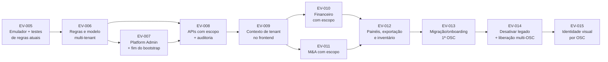

# 08 — Roadmap das evoluções

> SIGOSC-EV-004 · versão 1.0 · 06/11/2026. **Proposta para aprovação humana. Nenhuma evolução abaixo está autorizada.**
>
> Princípio: **segurança e isolamento antes de liberar múltiplas OSCs.** Cada EV é independente, testável e reversível. As dependências obrigatórias estão marcadas com ⛓.

## Visão geral

| EV | Título | Depende de | Pode ir para produção sozinha? |
|---|---|---|---|
| 005 | Base de testes de segurança | — | Sim (só testes e devDeps) |
| 006 | Modelo e regras multi-tenant (caminhos novos) | 005 | Sim: as regras novas são **aditivas** e negam tudo que não está modelado |
| 007 | Platform Admin e remoção do bootstrap por e-mail | 006 | ⛓ **Junto** com a remoção do e-mail nas regras, no front e na API |
| 008 | APIs administrativas com escopo + auditoria | 006, 007 | Sim, com a UI antiga ainda apontando para as APIs antigas |
| 009 | Contexto de tenant no frontend + camada de dados com escopo | 008 | ⛓ Só junto com EV-010 e EV-011 se mudar caminhos de dados |
| 010 | Financeiro com escopo | 009 | ⛓ Junto com EV-011 e EV-013 no corte |
| 011 | M&A com escopo | 009 | ⛓ Idem |
| 012 | Painéis, exportações e inventário somente leitura | 010, 011 | Junto com o corte |
| 013 | Migração (ou começo do zero) e entrada da 1ª OSC | 012 | É o **corte** |
| 014 | Desativação do legado e liberação multi-OSC | 013 | Sim, e é condição para a 2ª OSC |
| 015 | Identidade visual por OSC | 014 | Sim |

---

### SIGOSC-EV-005 — Base de testes de segurança
- **Objetivo:** criar a infraestrutura de testes de regras e de API com o Firebase Emulator e cobrir as **regras atuais** (linha de base).
- **Pré-requisitos:** aprovação para adicionar devDependencies (`firebase-tools`, `@firebase/rules-unit-testing`) e o arquivo `firebase.json` **só com a config do emulador** (sem deploy).
- **Alterações:** `firebase.json` (emuladores), `tests/rules/*.test.js`, script `npm run test:rules`, documentação.
- **Arquivos:** `package.json`, `firebase.json` (novo), `tests/` (novo).
- **Aceite:** testes das regras atuais (admin, permissões, imutabilidade da visita, pesquisas, default deny) verdes; validar a hipótese do listener revogado (04 §4.3).
- **Testes:** os próprios. **Riscos:** baixo. **Reversão:** remover os arquivos e as devDeps.
- **Ação manual recomendada já nesta fase:** desativar o sign-up público no Console (R01).

### SIGOSC-EV-006 — Modelo e regras multi-tenant
- **Objetivo:** escrever as regras dos caminhos novos (`organizations/**`, `platformAdmins`, `organizationCnpjIndex`, collection groups `members`/`access`) e os tipos TypeScript do domínio (02).
- **Pré-requisitos:** EV-005; ADR-002/004/005/008 aprovados.
- **Alterações:** `firestore.rules` (**acrescentando**, sem mexer nas regras atuais), `firestore.indexes.json` (novo), `src/domain/tenant.ts` (tipos), testes C01–C16 no nível das regras.
- **Aceite:** os casos RT de C01, C02, C04, C06, C07, C09, C11, C12, C13 e C15 verdes no emulador; regras atuais sem regressão.
- **Riscos:** limite de `get()` por regra; custo. **Reversão:** voltar à versão anterior de `firestore.rules`. Como os caminhos novos estão vazios, não há impacto.

### SIGOSC-EV-007 — Platform Admin e fim do bootstrap por e-mail ⛓
- **Objetivo:** criar `platformAdmins/{uid}` e o script `grant-platform-admin.mjs` (ADR-007), e **remover** o e-mail de `firestore.rules`, `src/firebase.ts` e `requireAdmin.ts`/`delete-user.ts`.
- **Dependência conjunta:** a remoção do e-mail e a existência de pelo menos 1 Platform Admin (e de `role:'admin'` no doc do administrador atual) precisam ir **no mesmo deploy**. Senão, ninguém administra.
- **Aceite:** o administrador atual continua administrando via `users.role` (enquanto o legado existe) e é Platform Admin; nenhuma ocorrência do e-mail no repositório (teste estático).
- **Riscos:** perder o acesso administrativo. **Reversão:** reverter o commit (o e-mail volta) e republicar as regras.

### SIGOSC-EV-008 — APIs com escopo e auditoria
- **Objetivo:** `requireUser`, `requirePlatformAdmin`, `requireOrgRole`, `requirePartnershipPermission`; os endpoints de 04 §5.2; `auditEvents`.
- **Pré-requisitos:** EV-006, EV-007.
- **Arquivos:** `api/_lib/*`, `api/platform/*`, `api/orgs/*` (novos); os antigos `api/admin/*` continuam até a EV-014.
- **Aceite:** os testes AT de C03, C08, C10, C14 e C16 verdes; auditoria gravada; nenhum campo de escopo lido do corpo.
- **Riscos:** autorização errada no Admin SDK. **Reversão:** desativar as rotas novas (a UI ainda não as usa).

### SIGOSC-EV-009 — Contexto de tenant no frontend ⛓
- **Objetivo:** `TenantProvider` (seleção de OSC e parceria, revalidação, `key` por contexto), `src/data/scope.ts`, teste estático contra `collection(db,'literal')`, e a Gestão de Membros usando as APIs da EV-008.
- **Arquivos:** `App.tsx`, `main.tsx`, `Header.tsx`, `DimensionSelect.tsx`, `UserManagement.tsx` e os modais, `src/data/scope.ts` (novo).
- **Dependência:** pode ser entregue com os módulos ainda nos caminhos legados **somente** enquanto houver uma OSC (07 §10).
- **Aceite:** UT de C04, C05 e C07; nenhuma regressão de navegação.
- **Riscos:** regressão de UX e de estado. **Reversão:** reverter o commit.

### SIGOSC-EV-010 — Financeiro com escopo ⛓
- **Objetivo:** levar `ledger` e `budgetItems` para os caminhos da parceria; extrair o módulo de `App.tsx`; paginação; bloquear a exclusão de item com despesas. Os anexos ficam como decisão (R12).
- **Aceite:** RT de C01, C02 e C06 aplicados ao ledger; testes de totais (`totals`/`chartData`) iguais aos da versão anterior com os mesmos dados.
- **Reversão:** reverter o commit; os dados novos ficam ignorados.

### SIGOSC-EV-011 — Monitoramento e Avaliação com escopo ⛓
- **Objetivo:** visitas, 30 dias (fim da coleção dinâmica), pesquisas (chave `{surveyType}__{id}`), relatório final e dados da parceria (fim de `settings/partnership`; `IDENTIFICACAO_INSTRUMENTO` passa a ser dado da parceria).
- **Aceite:** testes equivalentes às regras atuais (imutabilidade da visita, histórico imutável, formato das pesquisas) agora com escopo; `apuracao.test.js` continua verde.
- **Reversão:** reverter o commit.

### SIGOSC-EV-012 — Painéis, exportações e inventário
- **Objetivo:** painéis com escopo; decisão sobre `periodos`/`colaboradores_*`; exportação por tenant (servidor); script `inventory.mjs` somente leitura (07 §2).
- **Aceite:** painéis com os mesmos números em dados de teste; exportação de um tenant contém só dados dele.

### SIGOSC-EV-013 — Migração e entrada da 1ª OSC (corte)
- **Objetivo:** executar 07 §2–§11 com autorização explícita: inventário, decisão, backup, dry-run, execução, validação e corte.
- **Pré-requisitos:** EV-005 a EV-012 em `evo-dev` validadas; janela de manutenção acordada.
- **Aceite:** reconciliação de 07 §8 aprovada; C01–C16 verdes contra o ambiente.
- **Reversão:** 07 §9.

### SIGOSC-EV-014 — Desativação do legado e liberação multi-OSC
- **Objetivo:** regras legadas em `if false`; remover `api/admin/*`, `isDemoMode`, `handleFirestoreError` sem uso, os serviços da Apuração sem chamador, as chaves legadas de permissão e o e-mail residual; checklist 07 §12.
- **Aceite:** checklist 07 §12 completo + aprovação humana registrada.
- **Reversão:** reativar as regras legadas (os dados de origem ficam até o fim da retenção).

### SIGOSC-EV-015 — Identidade visual por OSC
- **Objetivo:** logo e nome da OSC no `LogoPlaceholder`/`Header`; upload pelo `org_admin` no Storage (`organizations/{org}/branding/`) com regras de Storage.
- **Pré-requisitos:** EV-014; ativar o Storage no Console.
- **Riscos:** upload de arquivo malicioso (validar tipo e tamanho). **Reversão:** voltar ao placeholder.

## Testes transversais exigidos em todas as EVs
`npm test`, `npm run lint`, `npm run build`, `firebaseIsolation.test.js` e, a partir da EV-005, `npm run test:rules`.
